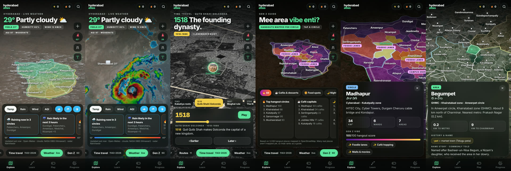

# Hyderabad Atlas

An Android app for learning Hyderabad's geography layer by layer, on a 3D satellite map styled after the realtor's pov reel about the 2026 three-corporation split.



**Install:** download [`release/HyderabadAtlas.apk`](release/HyderabadAtlas.apk) on your phone, open it, and allow "Install unknown apps" for your browser or file manager when asked. Android 8.0 or newer. You need internet for the satellite imagery. Each new version installs over the old one and keeps your progress.

## What's inside

| Level | Count | What you learn |
|---|---|---|
| Corporations | 3 | GHMC, Cyberabad, Malkajgiri (G.O. 55, 11 Feb 2026) |
| Zones | 12 | 6 GHMC + 3 Cyberabad + 3 Malkajgiri |
| Circles | 60 | official circle list with ward counts |
| Areas | 303 | neighbourhoods, each placed in its circle (162 with Telugu names) |
| Landmarks | 103 | heritage, lakes, temples and churches, campuses, malls, transit hubs; 101 with photos |
| Metro | 3 lines, 57 stations | station order, interchanges; MMTS rail shown too |
| Routes | 10 highways + ORR | NH44, NH65, NH163, Rajiv Rahadari, Srisailam, Sagar, PVNR Expressway, Old Mumbai Highway on real road geometry; all 21 ORR exits |

**Explore:** pick a depth (Corporations → Zones → Circles → Areas → Landmarks → Metro → Routes) and tap anything for:
- its parent hierarchy, neighbours and contents
- nearest metro and nearby landmarks
- a photo with credit (landmarks)

**Moving around the map:**
- Pan, zoom, rotate and tilt with gestures, or drag the camera dial with one thumb.
- Tilt follows zoom: flat over the city, steep in close.
- When zoomed in you get real 3D buildings, terrain relief, named roads and highway shields.
- **Orbit** circles slowly around any place.
- **Fly along** flies a drone camera down a metro line, highway, the ORR or the Musi, calling out stations and stops as it goes.

**History:**
- Name meanings for 269 places (-guda, -pally, -pet, -bagh, -abad…).
- 83 name stories, with literal meanings kept separate from commonly told origins.
- Wikipedia history for about 200 areas, loaded on the phone and credited.
- A time-travel view from 1143 to 2026: 7 eras, 36 events and 55 dated landmarks. Older eras look like old photographs, and the metro and ORR appear only once they exist.

**Weather** (free data, no keys):
- Every circle coloured by temperature, chance of rain, wind or air quality, with an hourly outlook per circle.
- Plain-language insights: rain likely soon, hottest and coolest circle, worst and cleanest air.
- Animated wind streaks.
- Live satellite clouds (NASA GIBS / Himawari, every 10 minutes) and rain radar (RainViewer).
- An India view for cyclones and the monsoon.
- An "Open in Zoom Earth" link at the same spot.

**Gen Z guide:**
- A hangout score and vibe tags per circle, from 3,400 mapped cafés, food spots, nightlife, malls and cinemas, gyms, colleges and parks.
- City leaderboards and top spots.
- Quick polls ("Mee area vibe enti?"). Answers are saved on the phone; shared results need a small backend later.

**Learn:** 9 phases, 54 lessons. Each lesson is a guided flyover, then a quiz. Score 70% to unlock the next lesson.

**Play:** 15 game modes:
- Daily mix
- Which came first?
- What's in a name
- Vibe check
- Pin drop
- Name it
- "Mee area ye corporation?"
- Compass
- Neighbours
- Metro master
- Picture this (name the place from its photo)
- ORR exits
- Route builder
- Fix my mistakes
- **Draw the route** (advanced): trace a metro line, highway, the ORR loop, the Musi or an MMTS line with your finger. The score combines how much of the real path you covered with how much of your line stayed on it, plus your average distance off. There are three levels: Easy, Pro and Expert (from memory on a dimmed map, 450 m tolerance).

Every answer feeds a spaced-repetition memory (Leitner boxes), so weak places keep coming back. XP, a daily streak and per-level mastery are tracked on the Progress tab.

**Settings:**
- Telugu names (తెలుగు)
- Lite mode for older phones (no 3D buildings or terrain; on by default for phones with ≤3 GB RAM or ≤4 cores)
- 3D terrain
- Tilt follows zoom
- Road map
- Labels

## Accuracy

- **Hierarchy (corporation, zone, circle, ward count):** from the official February 2026 lists published by Siasat and Telangana Today.
- **Area positions, metro, MMTS, ORR, exits, Musi and highways:** from OpenStreetMap.
- **Highways:** routed along the OSM motorway/trunk/primary network between hand-picked waypoints, preferring roads tagged with the highway's number.
- **Borders are approximate:** no official boundary file exists yet for the new circles. Each area gets a Voronoi cell around its OSM position, and cells merge into circles, zones and corporations, so the levels always nest. The assignment of areas to circles is hand-curated and may be wrong at the edges.
- **Symbols are generic:** highway shields and metro line colours are generic, not official logos. The app is not affiliated with GHMC, CMC, MMC, HMRL or the Government of Telangana.

## Before a large public launch

These matter once the app has many users. They don't matter for personal use.

1. **Satellite imagery licence.** Esri World Imagery is used here as a free basemap. At scale it needs a paid plan (Esri Location Platform, MapTiler, Mapbox or similar). Every provider URL lives in `web/js/config.js`, so switching is a one-line change.
2. **Vector tiles and terrain.** OpenFreeMap and the AWS terrain tiles are free with no stated limits, but heavy users are asked to self-host. Plan for a tile CDN.
3. **Photos.** Landmark photos load from Wikimedia Commons on the phone. Credits are fetched from the Commons API and cached. For scale, bundle or mirror them (`tools/fetch_photos.py` downloads them with credits).
4. **Official logos.** GHMC, CMC and MMC logos, the Telangana emblem and the Hyderabad Metro logo need written permission. Google Play rejects apps that imply government affiliation.
5. **Play Store release.** Use Play App Signing with a new upload key (not the sideload key in the repo), ship an AAB, and add a privacy policy. Progress is stored only on the phone.
6. **Weather at scale.** Today each phone calls Open-Meteo, whose free tier is for non-commercial use. At scale, run `tools/weather_snapshot.py` every 15 minutes (with a commercial key or a self-hosted Open-Meteo), host the file on a CDN, and set `CONFIG.weather.sharedUrl`. Then every phone shares one small file. RainViewer's free radar is for personal and small-scale use only.
7. **Gen Z polls.** Shared results need a backend (accounts, moderation). Once anyone can post free text, India's IT Rules apply. Under-18 users bring DPDP Act duties.
8. **Telugu UI.** Place names are bilingual where OSM/Wikidata have Telugu; the interface text is still English.

## Project layout

```
web/            the app (HTML/CSS/JS, MapLibre GL, data/atlas.json, img/places)
web/js/config.js  map data providers (swap here)
tools/          data pipeline
  hierarchy.py    curated lists: corporations, zones, circles, areas, landmarks
  build_data.py   regions, metro, base atlas
  fetch_photos.py landmark photos + credits from Wikimedia Commons
  build_extras.py highways on real roads, ORR exits, Musi, MMTS, Telugu names, photos
  history.py      name meanings, name stories, landmark years, timeline
  build_v3.py     history + Gen Z vibes into the atlas
  weather_snapshot.py  shared weather file for scale
tools/raw/      OpenStreetMap and Wikidata extracts used by the pipeline
android/        WebView shell that packages web/ as assets
release/        signed APK
```

## Rebuild

```bash
# data (only if you edit tools/hierarchy.py)
pip install shapely numpy
python3 tools/build_data.py
python3 tools/fetch_photos.py --meta   # photo URLs + Telugu labels for every landmark
python3 tools/fetch_photos.py          # optional: download photos to bundle (slow, rate-limited)
python3 tools/build_extras.py
python3 tools/build_v3.py              # history, timeline, Gen Z vibes

# try the app in a browser
cd web && python3 -m http.server 8000   # open http://localhost:8000

# Android APK (needs JDK 17 + Android SDK 35)
cd android && ./gradlew assembleRelease
cp app/build/outputs/apk/release/app-release.apk ../release/HyderabadAtlas.apk
```

The signing key in `android/keystore/` exists so every rebuild can update the installed app in place. Uninstalling would wipe your progress. It's a sideloading key only; don't reuse it for a Play Store release.

## Credits

- Imagery © Esri, Maxar, Earthstar Geographics.
- 3D buildings and roads © OpenFreeMap, OpenMapTiles, OpenStreetMap contributors.
- Terrain: AWS Terrain Tiles (Mapzen).
- Weather: Open-Meteo (CC BY 4.0); clouds: NASA GIBS / JMA Himawari; radar: RainViewer.
- History text: Wikipedia (CC BY-SA 4.0), loaded on the phone.
- Map data © OpenStreetMap contributors (ODbL).
- Landmark photos: Wikimedia Commons contributors (credited in the app on each photo).
- Map engine: MapLibre GL JS (BSD-3).
- Font: Inter (OFL).
