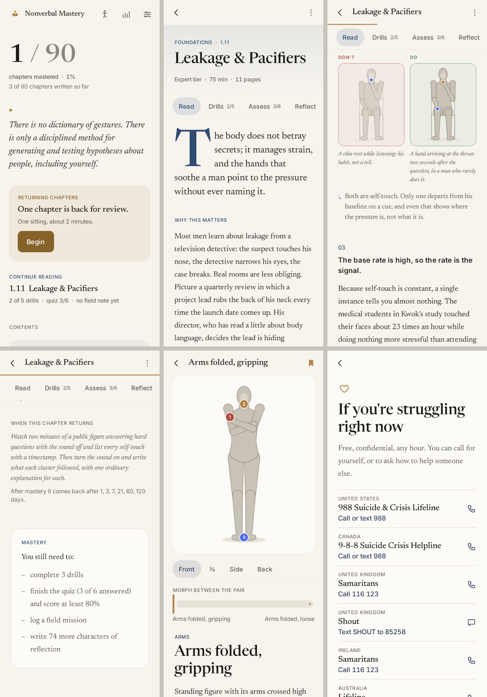
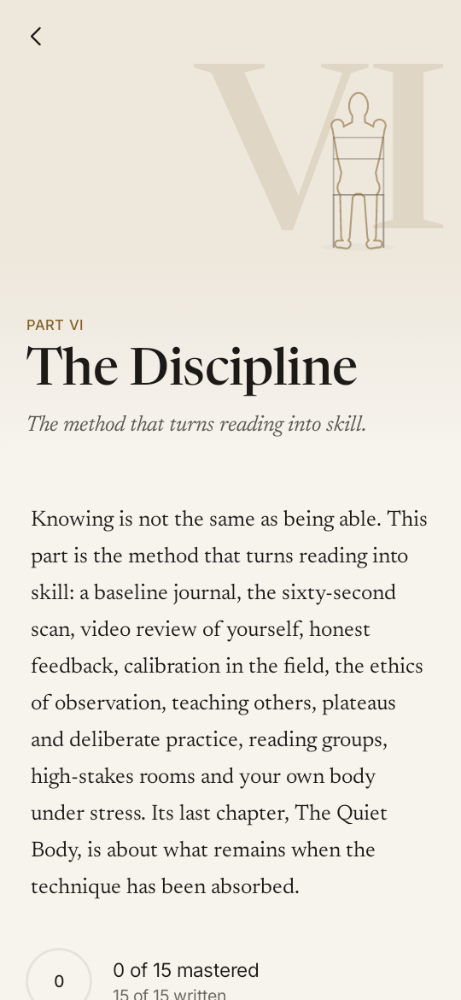
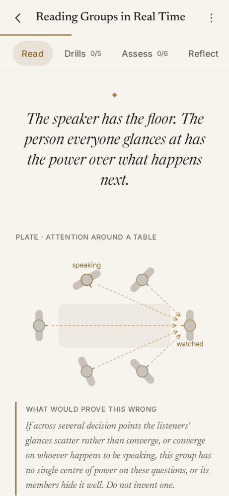
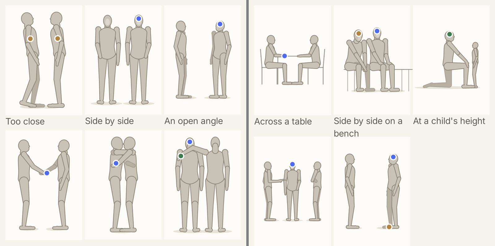

# Nonverbal Mastery

An Android book that teaches a man to read body language, read himself, and read the room — built on one thesis:

> There is no dictionary of gestures. There is only a disciplined method for generating and testing hypotheses about people, including yourself.

Kotlin 2.0 · Jetpack Compose · Room · DataStore · type-safe Navigation · fully offline · **no permissions requested** · no analytics, crash reporting or trackers.



## Status: v0.3 (Phases 1–3 complete)

| Area | State |
|---|---|
| Engine: design system, pose system, all 12 screens, mastery + spaced review, Room, settings, export/import | Done |
| Content | 18 of 90 chapters written to the full contract: all of Part VI, The Discipline (6.1–6.15), plus 1.1, 1.11 and 1.15. About 83,000 words, ≈185 pages. Ethics statement (1,205 words); crisis resources |
| Pose library | 125 poses in 13 themes, including two- and three-person scenes, + 6 drawn diagrams |
| Tests | 29 passing: content contract, engines, 46 screen renders, end-to-end smoke on API 26 and 34, full mastery flow through the real UI |
| Not yet verified | On a physical device or emulator (none available in the build environment); manual TalkBack audit; shared-element motion seen in motion |

See [`content/_progress.md`](content/_progress.md) for where authoring stopped, what later chapters must not repeat, and the open question about the page target.

 

## Build and test

```bash
# needs JDK 17+ and an Android SDK with platform 34 (set sdk.dir in local.properties)
./gradlew assembleDebug                 # app/build/outputs/apk/debug/app-debug.apk
./gradlew assembleRelease               # R8-minified, unsigned (~2.7 MB)
./gradlew testDebugUnitTest             # everything below
./gradlew testDebugUnitTest --tests '*ContentContractTest*' -i   # prints the content report
./gradlew recordPaparazziDebug          # renders every screen to app/src/test/snapshots/images
```

| Test | What it proves |
|---|---|
| `ContentContractTest` | Every written level meets the spec's content contract (word ranges, block counts, 5–6 questions with a misconception and a scenario, 3–6 pose pairs, real pose IDs). Plus stricter house rules: every teaching claim states its disconfirming condition, no stub markers, quiz answers spread across letters and never guessable by length (the right answer is at most 1.35× the longest wrong one, and the longest option in at most half the questions), no words broken by line-wrap hyphens, the ethics essay is present, the gzipped pack is under 2 MB. |
| `MasteryTest`, `ReviewSchedulerTest`, `BackupRoundTripTest` | Mastery criteria and their plain-language "you still need to" list, scoring, sequential unlocking across unwritten gaps, the 1/3/7/21/60/120-day schedule, and a lossless journal round-trip including unicode. |
| `AppSmokeTest` (Robolectric, API 26 and 34) | Launches the real `MainActivity` with Room, DataStore and the assembled pack, then walks home → category → chapter → quiz → ethics (from the chapter menu) → pose library → settings → crisis resources. |
| `MasteryFlowTest` | A reader masters Level 1.1 using only the UI: five drills, a field note, a perfect quiz, a 150-character reflection, then "Level mastered. The next one is open." |
| `ScreensTest`, `PoseSheetTest` (Paparazzi) | Every screen at 360dp in Paper and Ink; every pose. |

## Structure

```
content/                      ← the book, one file per chapter (source of truth)
  pack.meta.json              categories, outlines, crisis resources, ethics essay
  poses.json                  the pose library
  levels/<category>/NN-*.json one chapter per file
  _progress.md                authoring status and handoff
app/src/main/java/com/nonverbal/mastery/
  data/models|db|repo|seed    schema, Room, repositories, mastery + review engines
  design/tokens|theme|components|pose
  features/path|category|level|poselib|review|progress|settings|launch
  ui/nav                      type-safe routes, shared-element plumbing
app/src/main/assets/heroes/   image briefs (*.md); photos optional, drawn fallback built in
```

At build time the `assembleContentPack` Gradle task stitches `content/` into `assets/content/pack.json`. Authors never edit a single giant JSON file, and sessions can resume chapter by chapter. The loader also accepts `pack.json.gz` for when the full book outgrows the size budget.

## The pose system

Poses are drawn, never photographed. Each pose is a set of parameters solved into a 3D skeleton:

- **Two-bone IK.** Arm and leg presets name targets ("hand to the hollow of the throat", "ankles hooked under the chair") rather than angles.
- **Any camera angle.** The skeleton is projected orthographically, so one pose renders from front, three-quarter, side or back. The detail screen rotates it.
- **Readable silhouettes.** Each limb is a depth-sorted, unioned silhouette with its own hairline, so a forearm across the chest reads from the front. Far-side limbs are a shade deeper, like an anatomy plate.
- **Morphing.** Pose Detail can morph a DON'T pose into its DO counterpart to show exactly what changed.
- **Annotations.** Markers anchor to named landmarks (`left-shoulder`, `throat`, `feet`…). Every pose carries a prose description used by TalkBack.

- **Scenes.** A pose can include companion figures with a position, facing and size: greetings, proxemics, a circle of three, an adult kneeling to a child. Annotations address them as `b:head`, `c:left-hand`.
- **Bases and breath.** Standing, seated, kneeling (both knees or one) and squatting, plus `chestBreath` / `bellyBreath` that fill the front of the body.
- **Gaze.** `showGaze` draws the line of sight from the eyes, used for the glance plates.
- **Solid props.** A lectern is a board that depth-sorts with the limbs, so it hides the legs while the hands rest on top; chairs, tables, a laptop and a bench are drawn as quiet lines.

Preset libraries: 65 arm placements, 15 hand shapes, 32 leg stances. Left and right are always the figure's own.



## Where this deviates from the brief, and why

| Change | Reason |
|---|---|
| Text-safe variants of tertiary, brass, blue, green and red | Several specified hues fail WCAG AA for small text (tertiary #8A857D measured 3.3:1 on Paper; brass 3.1:1). The specified hues are kept for graphics. Measured values are in `Color.kt`. |
| Hairline outline on every figure | The specified figure fill is 1.6:1 against the page. The outline brings the silhouette edge above the 3:1 non-text minimum. |
| Additive, optional schema fields | `TeachBlock.disconfirm` (falsifiability becomes structural and testable), `TeachBlock.diagram`, `Pose.title/theme`, `PoseParams.view/headPitch/spineCurve/torsoTurn/prop` (a slump is not a lean; gaze needs pitch), `Category.outline/introduction`, `ContentPack.crisisResources/ethics`, `LevelProgress.fieldNote/lastOpenedAt`. All are defaulted, so older packs decode. |
| Chapter and screen titles in the display serif | Reads as a book rather than an app; Inter carries labels, claims and controls. |
| Crisis screen puts phone numbers first, ordered by the phone's locale | Someone in crisis should not scroll past paragraphs to find a number. The locale lookup needs no permission and sends nothing. |
| `allowBackup="false"`, no cloud backup | Reflections can be intimate. They leave the phone only through the explicit export. |
| Unwritten chapters appear in each table of contents as "Not yet written" | The shape of the book is part of the product. Unlocking is sequential over written chapters, so 1.11 opens after 1.1 even while 1.2–1.10 are unwritten. |
| A chapter is "retained" after its sixth review | Ends the review cycle rather than looping forever; nothing is ever locked. |

## Privacy

The APK requests no permissions. `aapt2 dump permissions` shows only `DYNAMIC_RECEIVER_NOT_EXPORTED_PERMISSION`, a signature permission AndroidX defines for its own receivers. Dialling a crisis line or sharing an export hands an intent to another app; this app never touches the network.

## Fonts

Newsreader (Production Type) and Inter (Rasmus Andersson) under the SIL Open Font License 1.1, bundled in `res/font`.
